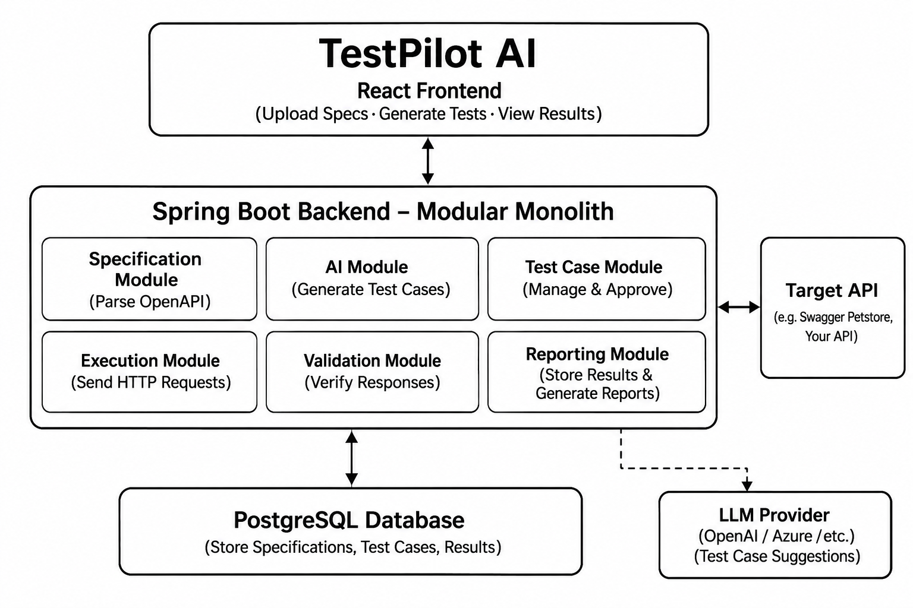

# TestPilot
### Intelligent API Testing Engine

### Description
TestPilot is an AI-powered API testing platform that automatically generates, executes, and analyzes API test cases using OpenAPI specifications, user-defined requirements, and boundary-value analysis.

### Problem Statement
Developers and QA engineers spend considerable time manually writing API test cases, configuring requests, validating responses, and identifying edge cases. Traditional API testing tools require users to create most test scenarios themselves, which can result in incomplete test coverage and overlooked defects.

### Functional Requirements
- Accept OpenAPI JSON and YAML files
- Parse API paths, methods, parameters and schemas
- Extract request and response definitions
- Generate test cases using an LLM
- Generate positive, negative and boundary tests
- Allow users to review generated test cases
- Execute HTTP requests against target APIs
- Validate status codes and response structures
- Record request and response details
- Generate execution summaries and reports
- Explain test failures in understandable language

### Technology Stack
| Layer | Technology |
| :--- | :--- |
| Frontend | React.js |
| Backend | Java 21 + Spring Boot |
| Database | PostgreSQL |
| ORM | Spring Data JPA + Hibernate |
| API communication | REST |
| HTTP execution | Java HttpClient |
| API documentation | OpenAPI / Swagger |
| AI integration | Spring AI or LLM provider abstraction |
| Backend testing | JUnit 5 + Mockito |
| Build tool | Maven |
| Version control | Git + GitHub |
| Containerization | Docker |

### Architecture 
